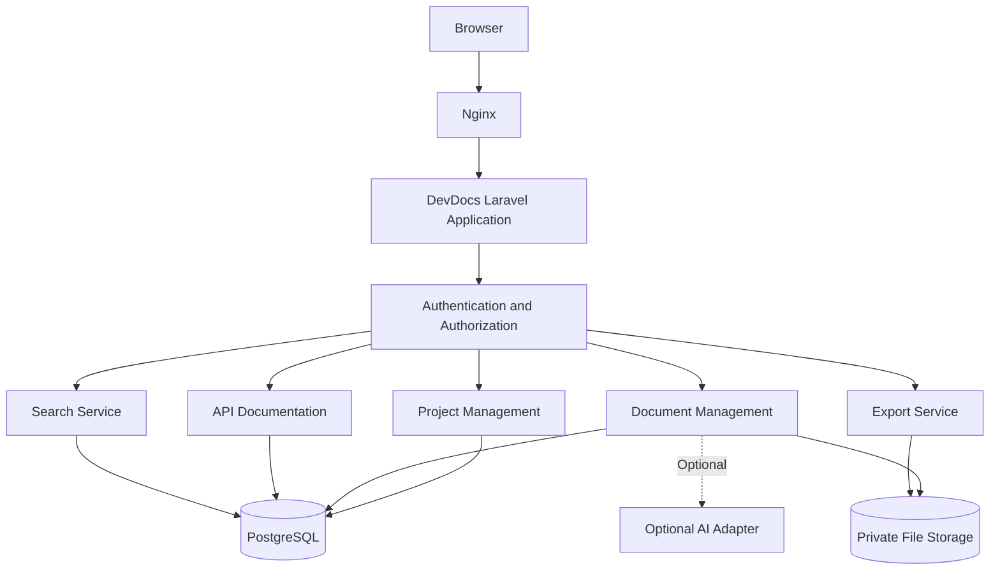
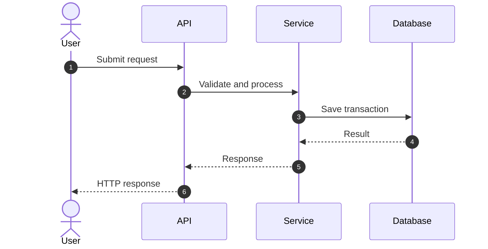
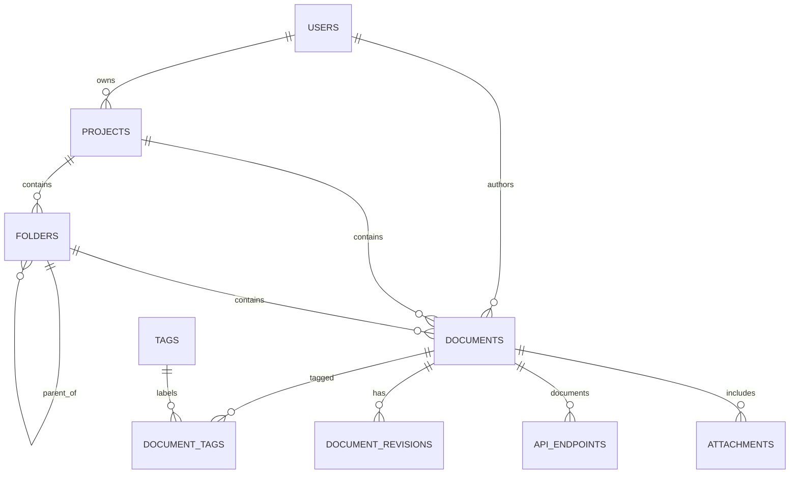

# PRODUCT REQUIREMENTS DOCUMENT (PRD)
# DevDocs — Personal Technical Documentation Platform

**Versi:** 2.1  
**Status:** Draft for Technical Design  
**Platform:** Private Web Application — Local Network  
**Arsitektur:** Laravel Full-Stack Monolith  
**Backend dan Rendering:** Laravel + Blade  
**Frontend Interaction:** JavaScript modular  
**Database:** PostgreSQL  
**AI Assistant:** Opsional, setelah MVP

---

## 1. Executive Summary

### 1.1 Latar Belakang

DevDocs adalah aplikasi dokumentasi teknis pribadi untuk mengelola dokumentasi software dalam satu tempat yang terstruktur.

Aplikasi ini ditujukan untuk developer dan IT engineer yang perlu mendokumentasikan API, arsitektur sistem, database, sequence diagram, source code, konfigurasi, dan troubleshooting.

DevDocs menggabungkan editor visual, Markdown, diagram, API documentation, pencarian, version history, dan export menjadi satu platform yang dapat dijalankan pada jaringan lokal.

### 1.2 Visi Produk

Menjadi pusat pengetahuan teknis yang membantu developer memahami, membangun, memelihara, dan mendokumentasikan sistem software secara konsisten.

### 1.3 Tujuan

1. Menyimpan seluruh dokumentasi teknis dalam satu aplikasi.
2. Mempermudah pembuatan Technical Specification Document (TSD).
3. Menyediakan editor visual dan Markdown dengan live preview.
4. Mendukung Mermaid sequence diagram, flowchart, dan ERD.
5. Menyediakan dokumentasi API dengan request, response, dan contoh cURL.
6. Memudahkan pencarian lintas proyek dan dokumen.
7. Menyediakan revision history dan pemulihan dokumen.
8. Mendukung export HTML dan PDF.
9. Dapat digunakan melalui jaringan lokal tanpa ketergantungan pada layanan cloud.
10. Menyediakan fondasi untuk integrasi AI di masa depan.

### 1.4 Prinsip Utama

- **Simplicity first:** hindari kompleksitas framework yang tidak dibutuhkan.
- **Single source of truth:** konten dokumen memiliki satu sumber kebenaran.
- **Security by default:** dokumen dan attachment bersifat privat secara default.
- **Data ownership:** konten dapat dicadangkan dan diekspor.
- **Modular monolith:** satu aplikasi dengan modul yang memiliki tanggung jawab jelas.
- **Incremental development:** fitur dibangun secara bertahap.
- **AI is optional:** fitur inti tidak bergantung pada AI.

---

## 2. Product Scope

### 2.1 MVP — Wajib tersedia

- Authentication dan authorization.
- Dashboard.
- Project management.
- Folder dan navigasi bertingkat.
- Document management.
- Editor visual.
- Markdown editor dan live preview.
- Code block dan syntax highlighting.
- Mermaid diagram.
- Dokumentasi API.
- Attachment management.
- Autosave dengan indikator status.
- Revision history.
- Full-text search.
- Export HTML dan PDF.
- Backup dan restore.
- Deployment menggunakan Docker Compose pada jaringan lokal.

### 2.2 Fitur setelah MVP

- Import OpenAPI/Swagger.
- Template TSD, API Specification, System Design, dan Runbook.
- Import dan export Markdown.
- Diff antar-revisi.
- Link antar-dokumen.
- Tag dan kategori.
- AI Documentation Assistant.
- Integrasi Git repository.
- Multi-user collaboration.

### 2.3 Out of Scope

- Frontend SPA berbasis Vue atau React.
- Public SaaS hosting.
- Aplikasi native mobile.
- API testing runner.
- Distributed microservices.
- Real-time collaborative editing pada versi awal.
- AI sebagai persyaratan untuk menjalankan fitur inti.

---

## 3. Target Pengguna dan Use Cases

### 3.1 Target pengguna

**Developer:** mendokumentasikan API, fitur, integrasi, database, dan troubleshooting.

**IT Engineer:** mendokumentasikan konfigurasi, deployment, infrastruktur, dan prosedur operasional.

**Future team member:** membaca atau mengedit dokumentasi sesuai hak akses.

### 3.2 Use cases utama

| ID | Use case | Hasil |
|---|---|---|
| UC-01 | Membuat proyek | Proyek tersimpan dan dapat diakses |
| UC-02 | Membuat TSD | Dokumen terstruktur dengan heading, tabel, dan kode |
| UC-03 | Mengedit Markdown | Konten dirender melalui live preview |
| UC-04 | Membuat diagram | Diagram Mermaid tersimpan dan dirender |
| UC-05 | Mendokumentasikan API | Endpoint dan kontrak API tersimpan |
| UC-06 | Mencari dokumentasi | Dokumen ditemukan melalui judul atau isi |
| UC-07 | Memulihkan revisi | Konten versi lama dapat dipulihkan |
| UC-08 | Export dokumentasi | HTML dan PDF dapat diunduh |
| UC-09 | Mengelola attachment | File tersimpan dan dapat diakses sesuai izin |
| UC-10 | Generate dengan AI | Draft dokumentasi dapat ditinjau sebelum disimpan |

---

## 4. Technology Stack

| Layer | Teknologi | Tanggung jawab |
|---|---|---|
| Application | Laravel | Business logic, routing, validation |
| Rendering | Blade | Server-rendered HTML |
| Styling | Tailwind CSS | UI dan responsive layout |
| Browser interaction | Vanilla JavaScript | Autosave dan interaksi editor |
| Rich text editor | Tiptap atau alternatif setara | Editor visual |
| Markdown | Parser yang kompatibel | Parsing, preview, dan export |
| Diagram | Mermaid.js | Sequence diagram dan flowchart |
| Code highlighting | Highlight.js atau setara | Syntax highlighting |
| Database | PostgreSQL | Data utama dan pencarian |
| File storage | Laravel Filesystem | Attachment dan file export |
| Web server | Nginx | HTTP serving |
| Runtime | PHP-FPM | Eksekusi Laravel |
| Deployment | Docker Compose | Pengelolaan service lokal |

Versi dependency dipilih berdasarkan kompatibilitas pada saat implementasi dimulai dan dikunci melalui dependency lock files.

Tidak diperlukan Vue, React, atau SPA terpisah. JavaScript tetap digunakan untuk fitur browser yang memerlukan interaksi tinggi.

---

## 5. System Architecture

### 5.1 High-level architecture



Diagram ini menunjukkan satu aplikasi Laravel modular, bukan microservices yang harus dideploy secara terpisah.

### 5.2 Prinsip arsitektur

1. Laravel menjadi pusat business logic dan authorization.
2. Blade menangani rendering halaman.
3. JavaScript digunakan secara modular pada editor, preview, dan interaksi browser.
4. PostgreSQL menjadi sumber kebenaran untuk data terstruktur.
5. Attachment disimpan pada filesystem, bukan sebagai blob besar dalam tabel dokumen.
6. AI diintegrasikan melalui adapter opsional.
7. Fitur inti tetap berfungsi saat layanan AI tidak tersedia.

### 5.3 Struktur folder yang direkomendasikan

```text
devdocs/
├── app/
│   ├── Domain/
│   │   ├── Projects/
│   │   ├── Documents/
│   │   ├── ApiDocumentation/
│   │   ├── Attachments/
│   │   ├── Revisions/
│   │   └── Export/
│   ├── Http/
│   │   ├── Controllers/
│   │   ├── Requests/
│   │   └── Middleware/
│   ├── Models/
│   ├── Policies/
│   ├── Services/
│   └── Jobs/
├── resources/
│   ├── views/
│   │   ├── layouts/
│   │   ├── dashboard/
│   │   ├── projects/
│   │   ├── documents/
│   │   └── api-docs/
│   ├── css/
│   └── js/
│       ├── editor/
│       ├── markdown/
│       └── mermaid/
├── routes/
├── database/
│   ├── migrations/
│   ├── factories/
│   └── seeders/
└── tests/
    ├── Unit/
    ├── Feature/
    └── Integration/
```

Struktur tersebut merupakan panduan. Direktori dibuat ketika modul mulai dikembangkan, bukan sebagai kewajiban membuat semua folder kosong sejak awal.

---

## 6. Functional Requirements

### 6.1 Authentication

Fitur:

- Login dan logout.
- Pengelolaan session.
- Pengubahan password.
- Proteksi endpoint administratif.
- Rate limiting login.

Peran awal:

- `admin`: mengelola semua proyek dan pengguna.
- `editor`: membuat dan memperbarui dokumentasi.
- `viewer`: membaca dokumentasi yang diizinkan.

Untuk penggunaan pribadi, MVP dapat dimulai dengan satu akun admin. Namun, struktur authorization tetap harus mendukung penambahan pengguna.

### 6.2 Dashboard

Dashboard menampilkan:

- Proyek aktif.
- Dokumen terbaru.
- Dokumen terakhir diedit.
- Pencarian global.
- Aksi membuat proyek dan dokumen.
- Jumlah proyek dan dokumen.

Data harus menggunakan query yang dibatasi dan pagination bila diperlukan. Dashboard tidak boleh memuat seluruh isi semua dokumen sekaligus.

### 6.3 Project Management

Pengguna dapat:

- Membuat dan mengedit proyek.
- Mengarsipkan dan memulihkan proyek.
- Memberikan nama, slug, deskripsi, dan ikon.
- Membuka halaman overview.
- Mengelola folder dan dokumen.

Contoh URL:

```text
/projects/payment-center
/projects/kawitan
/projects/mebanjar
```

Slug digunakan sebagai identifier URL, bukan pengganti primary key internal.

### 6.4 Folder Management

Folder mendukung hierarki bertingkat.

```text
Payment Center
├── Overview
├── Architecture
│   ├── System Architecture
│   └── Sequence Diagrams
├── API Documentation
│   ├── Access Token
│   └── QRIS Callback
├── Database
└── Troubleshooting
```

Persyaratan:

- Membuat, mengedit, dan mengurutkan folder.
- Memindahkan folder.
- Mencegah circular hierarchy.
- Membatasi folder pada proyek yang sama.
- Mencegah penghapusan dokumen secara tidak sengaja.
- Menyediakan urutan navigasi yang dapat diubah.

### 6.5 Document Management

Setiap dokumen memiliki:

- Judul dan slug.
- Ringkasan.
- Konten.
- Proyek.
- Folder opsional.
- Author dan last editor.
- Status.
- Tag.
- Created dan updated timestamps.
- Revision history.

Status:

- `draft`
- `published`
- `archived`

Penghapusan dokumen menggunakan soft delete agar kesalahan dapat dipulihkan.

### 6.6 Editor Visual dan Markdown

**Visual mode**

Mendukung:

- Heading H1–H6.
- Bold dan italic.
- Bullet dan numbered list.
- Tabel.
- Blockquote.
- Link.
- Image.
- Inline code.
- Code block.
- Horizontal divider.
- Diagram block.

**Markdown mode**

Mendukung:

- Penulisan Markdown langsung.
- Live preview.
- Code fence.
- Tabel dan link.
- Image.
- Mermaid code blocks.
- Shortcut editor.

**Konsistensi konten**

Untuk menghindari kehilangan format ketika berpindah mode:

1. Tetapkan satu representasi konten yang menjadi sumber kebenaran.
2. Gunakan Markdown sebagai format pertukaran dan ekspor.
3. Jika editor visual menggunakan structured JSON, konversi Markdown harus dilakukan melalui converter yang teruji.
4. Jangan mengubah atau menghilangkan node yang tidak didukung secara diam-diam.
5. Tampilkan peringatan jika ada konten yang belum didukung oleh mode tertentu.
6. Tambahkan test round-trip untuk format yang didukung.

Autosave harus memiliki indikator `Saving`, `Saved`, dan `Error`. Jika penyimpanan gagal, konten yang sedang diedit tidak boleh langsung dihapus.

### 6.7 Diagram Builder

Menggunakan Mermaid.js untuk:

- Sequence diagram.
- Flowchart.
- ERD.
- State diagram.

Persyaratan:

- Source diagram dapat diedit.
- Preview dapat diperbarui.
- Kesalahan sintaks ditampilkan.
- Diagram yang invalid tidak merusak seluruh dokumen.
- Diagram dapat dirender dalam tampilan baca dan export.

Contoh:



### 6.8 API Documentation

Setiap endpoint memiliki:

- Nama.
- HTTP method.
- Path.
- Deskripsi.
- Authentication.
- Headers.
- Path dan query parameters.
- Request body.
- Response body.
- HTTP status codes.
- Contoh cURL.
- Catatan teknis.

Contoh:

```text
POST /api/v1.0/qr/qr-mpm-notify

Purpose:
Receive QRIS MPM payment notification.

Headers:
Authorization: Bearer <token>
X-TIMESTAMP: <timestamp>
X-SIGNATURE: <signature>
X-PARTNER-ID: <partner-id>
Content-Type: application/json
```

Credential asli tidak boleh dimasukkan ke contoh dokumentasi yang dipublikasikan. Gunakan placeholder.

### 6.9 Search

Pencarian mencakup:

- Nama proyek.
- Judul dokumen.
- Ringkasan.
- Isi dokumen.
- Tag.
- Nama endpoint API.

Gunakan PostgreSQL Full Text Search pada MVP. Search engine eksternal belum diperlukan.

Hasil pencarian menampilkan judul, proyek, cuplikan teks, dan tanggal perubahan terakhir.

### 6.10 Version History

Setiap perubahan dokumen yang tersimpan dapat menghasilkan revisi.

Fitur:

- Daftar revisi.
- Tanggal dan author revisi.
- Membuka revisi lama.
- Memulihkan revisi.
- Ringkasan perubahan.

Version history harus menyimpan snapshot konten. Pemulihan revisi menghasilkan revisi baru agar jejak perubahan tidak hilang.

### 6.11 Attachment Management

Attachment mencakup gambar, diagram, dan file referensi.

Persyaratan:

- Validasi ukuran dan MIME type.
- Nama file penyimpanan yang aman.
- Metadata file tersimpan di database.
- File disimpan pada storage privat.
- Download dilakukan melalui endpoint yang memeriksa authorization.
- Penghapusan attachment tidak boleh meninggalkan referensi rusak tanpa penanganan.

### 6.12 Export

**HTML export**

- Mempertahankan heading, tabel, code block, gambar, dan diagram.
- Dapat dibuka sebagai file mandiri.
- Memuat navigasi dokumen jika sesuai.

**PDF export**

- Mempertahankan format konten.
- Mendukung page break.
- Mengurangi pemotongan tabel dan diagram.
- Menampilkan judul serta metadata dokumen.

Proses export menggunakan renderer yang konsisten dan tidak sekadar mengambil screenshot editor.

### 6.13 AI Assistant — Opsional

AI ditambahkan setelah fitur inti stabil.

Kemampuan yang direncanakan:

- Membuat draft TSD dari deskripsi.
- Mengubah log menjadi dokumentasi.
- Membuat draft sequence diagram.
- Merapikan dokumentasi.
- Menjelaskan kode dan error.

AI hanya menghasilkan draft yang dapat ditinjau pengguna. AI tidak boleh menerbitkan atau menimpa dokumen secara otomatis tanpa persetujuan.

---

## 7. Database Design

### 7.1 ERD



### 7.2 Tabel `users`

| Kolom | Tipe | Keterangan |
|---|---|---|
| id | BIGINT | Primary key |
| name | VARCHAR(150) | Nama pengguna |
| email | VARCHAR(255) | Email unik |
| password | VARCHAR(255) | Password hash |
| role | VARCHAR(30) | Peran |
| created_at | TIMESTAMP | Waktu pembuatan |
| updated_at | TIMESTAMP | Waktu perubahan |

Gunakan autentikasi Laravel dan hashing password yang aman.

### 7.3 Tabel `projects`

| Kolom | Tipe | Keterangan |
|---|---|---|
| id | BIGINT | Primary key |
| owner_id | BIGINT | FK users |
| name | VARCHAR(200) | Nama proyek |
| slug | VARCHAR(220) | Identifier URL |
| description | TEXT | Deskripsi |
| icon | VARCHAR(100) nullable | Ikon |
| status | VARCHAR(20) | active, archived |
| created_at | TIMESTAMP | Waktu pembuatan |
| updated_at | TIMESTAMP | Waktu perubahan |

### 7.4 Tabel `folders`

| Kolom | Tipe | Keterangan |
|---|---|---|
| id | BIGINT | Primary key |
| project_id | BIGINT | FK projects |
| parent_id | BIGINT nullable | FK folders |
| name | VARCHAR(200) | Nama folder |
| position | INTEGER | Urutan |
| created_at | TIMESTAMP | Waktu pembuatan |
| updated_at | TIMESTAMP | Waktu perubahan |

### 7.5 Tabel `documents`

| Kolom | Tipe | Keterangan |
|---|---|---|
| id | BIGINT | Primary key |
| project_id | BIGINT | FK projects |
| folder_id | BIGINT nullable | FK folders |
| author_id | BIGINT | FK users |
| last_editor_id | BIGINT nullable | FK users |
| title | VARCHAR(250) | Judul |
| slug | VARCHAR(280) | Identifier URL |
| summary | TEXT nullable | Ringkasan |
| content | JSONB | Struktur konten editor |
| content_markdown | TEXT nullable | Format pertukaran dan ekspor |
| status | VARCHAR(20) | draft, published, archived |
| version | INTEGER | Nomor versi saat ini |
| published_at | TIMESTAMP nullable | Waktu publikasi |
| created_at | TIMESTAMP | Waktu pembuatan |
| updated_at | TIMESTAMP | Waktu perubahan |
| deleted_at | TIMESTAMP nullable | Soft delete |

Desain `content` dan `content_markdown` memerlukan satu mekanisme sinkronisasi yang eksplisit. Keduanya tidak boleh diedit secara independen tanpa aturan konversi dan validasi.

### 7.6 Tabel `document_revisions`

| Kolom | Tipe | Keterangan |
|---|---|---|
| id | BIGINT | Primary key |
| document_id | BIGINT | FK documents |
| editor_id | BIGINT | FK users |
| revision_number | INTEGER | Nomor revisi |
| title | VARCHAR(250) | Snapshot judul |
| content_snapshot | JSONB | Snapshot konten |
| content_markdown | TEXT nullable | Snapshot Markdown |
| change_summary | TEXT nullable | Ringkasan perubahan |
| created_at | TIMESTAMP | Waktu revisi |

Constraint: kombinasi `document_id` dan `revision_number` harus unik.

### 7.7 Tabel `tags`

| Kolom | Tipe | Keterangan |
|---|---|---|
| id | BIGINT | Primary key |
| name | VARCHAR(100) | Nama tag |
| slug | VARCHAR(120) | Identifier tag |

### 7.8 Tabel `document_tags`

| Kolom | Tipe | Keterangan |
|---|---|---|
| document_id | BIGINT | FK documents |
| tag_id | BIGINT | FK tags |

Primary key gabungan: `document_id`, `tag_id`.

### 7.9 Tabel `api_endpoints`

| Kolom | Tipe | Keterangan |
|---|---|---|
| id | BIGINT | Primary key |
| document_id | BIGINT | FK documents |
| name | VARCHAR(200) | Nama endpoint |
| method | VARCHAR(10) | HTTP method |
| path | VARCHAR(500) | Path endpoint |
| description | TEXT nullable | Deskripsi |
| authentication | VARCHAR(100) nullable | Jenis autentikasi |
| headers | JSONB | Header |
| parameters | JSONB | Parameter |
| request_body | JSONB nullable | Request |
| responses | JSONB | Response |
| created_at | TIMESTAMP | Waktu pembuatan |
| updated_at | TIMESTAMP | Waktu perubahan |

### 7.10 Tabel `attachments`

| Kolom | Tipe | Keterangan |
|---|---|---|
| id | BIGINT | Primary key |
| document_id | BIGINT | FK documents |
| uploader_id | BIGINT | FK users |
| original_name | VARCHAR(255) | Nama asli |
| storage_path | VARCHAR(500) | Lokasi file |
| mime_type | VARCHAR(150) | MIME type |
| size_bytes | BIGINT | Ukuran file |
| created_at | TIMESTAMP | Waktu unggah |

### 7.11 Index dan constraints

Index yang direkomendasikan:

- `projects.owner_id`
- `documents.project_id`
- `documents.folder_id`
- `documents.status`
- `document_revisions.document_id`
- `api_endpoints.document_id`
- GIN index untuk pencarian full-text jika sesuai dengan strategi search.

Foreign key, aturan penghapusan, unique constraints, dan transaksi harus ditetapkan dalam migrations.

---

## 8. Web Routes dan Backend Design

Karena DevDocs menggunakan Laravel Blade, sebagian besar navigasi menggunakan web routes, bukan REST API yang terpisah.

### 8.1 Contoh halaman

| Method | Route | Fungsi |
|---|---|---|
| GET | `/dashboard` | Dashboard |
| GET | `/projects` | Daftar proyek |
| GET | `/projects/create` | Form proyek baru |
| POST | `/projects` | Membuat proyek |
| GET | `/projects/{project}` | Detail proyek |
| GET | `/documents/create` | Form dokumen baru |
| POST | `/documents` | Membuat dokumen |
| GET | `/documents/{document}` | Membaca dokumen |
| GET | `/documents/{document}/edit` | Editor dokumen |
| PUT/PATCH | `/documents/{document}` | Menyimpan perubahan |
| POST | `/documents/{document}/publish` | Publikasi |
| GET | `/documents/{document}/revisions` | Riwayat revisi |
| POST | `/documents/{document}/restore/{revision}` | Memulihkan revisi |
| GET | `/search` | Pencarian |
| POST | `/documents/{document}/export` | Menyiapkan export |

Route aktual ditetapkan pada implementasi dan harus dilindungi middleware serta policy yang sesuai.

### 8.2 Controller dan Service

Controller bertanggung jawab untuk:

- Menerima request.
- Memvalidasi input melalui Form Request.
- Memeriksa authorization.
- Memanggil business service.
- Mengembalikan view atau response yang sesuai.

Business logic seperti penyimpanan revisi, pemulihan dokumen, dan pemrosesan export ditempatkan di service atau action class.

Hindari controller yang menangani seluruh proses secara langsung.

### 8.3 Penyimpanan dokumen

Penyimpanan konten dan pembuatan revision snapshot harus dilakukan dalam transaksi database.

Gunakan optimistic locking melalui nomor versi atau mekanisme setara untuk mencegah perubahan lama menimpa perubahan yang lebih baru.

Jika versi dokumen yang dikirim tidak cocok dengan versi terbaru di database, aplikasi harus mendeteksi konflik dan meminta pengguna memuat ulang atau membandingkan perubahan.

### 8.4 Autosave

Autosave menggunakan request JavaScript ke route Laravel.

Persyaratan:

- Debounce agar tidak mengirim request setiap ketikan.
- Indikator status penyimpanan.
- Penanganan timeout dan kegagalan.
- Pencegahan request lama menimpa request baru.
- Deteksi konflik versi.
- Konten tetap tersedia di editor ketika penyimpanan gagal.

Autosave tidak berarti setiap ketikan harus menghasilkan revision snapshot. Revision dibuat berdasarkan perubahan yang benar-benar disimpan dan aturan versioning yang ditetapkan.

---

## 9. UI/UX Requirements

### 9.1 Layout

Tiga area utama:

1. Sidebar kiri untuk proyek, folder, dan dokumen.
2. Area tengah untuk editor atau pembaca dokumentasi.
3. Area kanan untuk table of contents atau outline.

Layout harus responsif dan tetap nyaman digunakan pada layar laptop.

### 9.2 Halaman utama

**Dashboard**
- Project cards.
- Recent documents.
- Search.
- Create project.
- Create document.

**Project overview**
- Informasi proyek.
- Folder dan dokumen.
- Aktivitas terakhir.

**Document editor**
- Judul.
- Visual/Markdown mode.
- Live preview.
- Save status.
- Publish control.
- Revision history.

**Document reader**
- Sidebar.
- Table of contents.
- Konten.
- Diagram.
- Code block dengan tombol copy.
- Informasi revisi.

### 9.3 Keyboard shortcuts

- `Ctrl + S`: simpan dokumen.
- `Ctrl + K`: pencarian.
- `Ctrl + B`: bold.
- `Ctrl + I`: italic.

Shortcut tambahan dapat ditetapkan berdasarkan kemampuan editor dan tidak boleh mengganggu shortcut browser yang umum tanpa alasan.

---

## 10. Security Requirements

### 10.1 Authentication dan authorization

- Gunakan session-based authentication Laravel.
- Lindungi route dengan middleware.
- Gunakan Laravel Policies untuk proyek dan dokumen.
- Periksa akses pada setiap operasi baca, edit, publish, restore, dan download.
- Jangan mengandalkan penyembunyian tombol di frontend sebagai kontrol keamanan.

### 10.2 Konten HTML dan Markdown

Konten dokumentasi merupakan input yang tidak selalu tepercaya.

- Sanitasi HTML sebelum dirender.
- Hindari menjalankan HTML mentah tanpa sanitasi.
- Batasi URL pada protokol yang diperbolehkan.
- Periksa risiko XSS pada link, image, dan embedded content.
- Mermaid harus dirender dengan konfigurasi keamanan yang sesuai.
- Code block harus ditampilkan sebagai teks, bukan dieksekusi.

### 10.3 File upload

- Validasi MIME type dan ukuran.
- Gunakan nama penyimpanan yang dihasilkan server.
- Simpan file privat di luar public web root jika memungkinkan.
- Akses file melalui controller yang memeriksa izin.
- Terapkan kebijakan penghapusan file yatim.
- Batasi format attachment yang didukung.

### 10.4 Network security

- Akses dibatasi ke jaringan yang diizinkan.
- PostgreSQL tidak dibuka langsung ke seluruh jaringan tanpa kebutuhan.
- HTTPS digunakan jika diperlukan oleh lingkungan deployment.
- Secret dan API key disimpan di environment atau secret management yang sesuai.
- Backup tidak boleh dapat diunduh oleh pengguna tanpa izin.

---

## 11. Non-Functional Requirements

### 11.1 Performance

Sasaran awal:

- Dashboard terbuka sekitar 2 detik pada jaringan lokal untuk dataset normal.
- Pencarian merespons sekitar 1 detik pada dataset awal.
- Navigasi dokumen terasa responsif.
- Penyimpanan dokumen tidak memerlukan reload halaman.

Target harus diverifikasi melalui pengujian, bukan dianggap sebagai jaminan sebelum pengukuran.

### 11.2 Reliability

- Konten tersimpan tidak hilang ketika halaman direfresh.
- Kegagalan autosave terlihat oleh pengguna.
- Konflik perubahan tidak ditimpa secara diam-diam.
- Backup database dan attachment dilakukan secara berkala.
- Restore diuji secara berkala.

### 11.3 Maintainability

- Pemisahan domain dan business logic.
- Database migrations.
- Unit dan feature tests.
- Dependency lock files.
- Logging yang tidak membocorkan credential.
- Dokumentasi instalasi dan deployment.
- Error handling konsisten.

---

## 12. Deployment Architecture

### 12.1 Target deployment

DevDocs berjalan pada satu komputer atau server di jaringan lokal.

Contoh alamat:

`http://192.168.1.100`

Alamat tersebut hanya contoh; IP atau hostname aktual ditetapkan saat deployment.

### 12.2 Docker Compose

Service yang direkomendasikan:

- Nginx.
- PHP-FPM dengan Laravel.
- PostgreSQL.
- Persistent storage untuk attachment.
- Worker opsional untuk proses export yang berat.

Untuk MVP, jangan menambahkan Redis atau service queue eksternal jika belum dibutuhkan. Gunakan mekanisme synchronous untuk proses ringan dan tambahkan queue ketika ada pekerjaan yang benar-benar membutuhkan pemrosesan asynchronous.

### 12.3 Backup dan restore

Backup mencakup:

- Database PostgreSQL.
- Attachment.
- Konfigurasi deployment yang diperlukan.
- File ekspor yang memang perlu dipertahankan.

Backup harus memiliki prosedur restore yang terdokumentasi dan diuji.

---

## 13. Testing Strategy

### 13.1 Unit tests

- Validasi slug.
- Status dokumen.
- Konversi konten.
- Revision numbering.
- Folder hierarchy.
- Authorization rules.

### 13.2 Feature tests

- CRUD proyek.
- CRUD folder.
- CRUD dokumen.
- Publish dan archive.
- Autosave.
- Revision history dan restore.
- Search.
- Attachment.
- Export.

### 13.3 Integration tests

- Markdown dapat dirender dan diekspor.
- Konten editor dapat disimpan dan dibuka kembali.
- Diagram Mermaid dapat dirender.
- Revision snapshot konsisten.
- Konflik versi dapat dideteksi.
- Attachment hanya dapat diakses oleh pengguna yang berhak.

### 13.4 Security tests

- Pengguna tanpa autentikasi ditolak.
- Viewer tidak dapat mengedit.
- Pengguna tidak dapat mengakses proyek yang tidak diizinkan.
- HTML berbahaya tidak dieksekusi.
- File yang tidak diizinkan ditolak.
- Secret tidak muncul dalam hasil ekspor atau log.

---

## 14. Implementation Milestones

### Milestone 1 — Foundation

Scope:
- Setup Laravel.
- Konfigurasi PostgreSQL.
- Setup Blade dan Tailwind CSS.
- Authentication.
- Role dasar.
- Layout aplikasi.
- Docker Compose development environment.

Deliverables:
- DevDocs dapat dijalankan.
- Pengguna dapat login.
- Database dan struktur aplikasi siap.

Exit criteria:
- Authentication berfungsi.
- Route privat terlindungi.
- Migration dapat dijalankan dari database kosong.

### Milestone 2 — Projects dan Documents

Scope:
- CRUD proyek.
- Folder bertingkat.
- CRUD dokumen.
- Sidebar.
- Draft, published, archived.
- Document reader.

Deliverables:
- Pengelolaan dokumentasi dasar.

Exit criteria:
- Project dan document dapat dikelola.
- Folder hierarchy tervalidasi.
- Penghapusan tidak merusak data secara tidak sengaja.

### Milestone 3 — Editor

Scope:
- Visual editor.
- Markdown mode.
- Live preview.
- Code block.
- Tables dan images.
- Autosave.
- Konflik versi.

Deliverables:
- Editor dokumentasi yang dapat digunakan sehari-hari.

Exit criteria:
- Konten tersimpan dengan konsisten.
- Pergantian mode tidak menghilangkan format yang didukung.
- Kegagalan penyimpanan dapat dipulihkan.

### Milestone 4 — Mermaid Diagram

Scope:
- Sequence diagram.
- Flowchart.
- ERD.
- Diagram source editor.
- Preview dan error handling.

Deliverables:
- Dokumentasi dapat menampilkan diagram.

Exit criteria:
- Diagram tersimpan dan dirender.
- Syntax error tidak merusak seluruh dokumen.

### Milestone 5 — API Documentation

Scope:
- API endpoint management.
- Headers dan parameters.
- Request/response.
- Contoh cURL.
- API reference page.

Deliverables:
- Modul dokumentasi API.

Exit criteria:
- Endpoint dapat dibuat dan ditampilkan dengan benar.
- Contoh request menggunakan placeholder untuk credential.

### Milestone 6 — Search dan Version History

Scope:
- PostgreSQL Full Text Search.
- Revision snapshots.
- Revision list.
- Restore.
- Tags.

Deliverables:
- Search dan revision history.

Exit criteria:
- Dokumen dapat ditemukan berdasarkan judul dan isi.
- Revisi lama dapat dipulihkan dengan aman.

### Milestone 7 — Export dan Deployment

Scope:
- HTML export.
- PDF export.
- Docker Compose production configuration.
- Nginx.
- Persistent storage.
- Backup dan restore.

Deliverables:
- DevDocs siap digunakan melalui jaringan lokal.

Exit criteria:
- Export dapat dibuka dan dibaca.
- Pengguna jaringan yang diizinkan dapat mengakses aplikasi.
- Backup dan restore telah diuji.

### Milestone 8 — Optional AI Assistant

Scope:
- Generate draft dokumentasi.
- Generate diagram dari deskripsi.
- Penjelasan kode dan log.
- Revisi konten berbantuan AI.

Deliverables:
- AI assistant terintegrasi secara opsional.

Exit criteria:
- Hasil AI selalu dapat ditinjau sebelum disimpan.
- AI tidak mengubah dokumen tanpa persetujuan.
- Aplikasi tetap berfungsi tanpa AI.

---

## 15. Risks and Mitigations

| Risiko | Mitigasi |
|---|---|
| Konten hilang ketika berganti mode editor | Tetapkan format konten dan lakukan round-trip testing |
| Autosave menimpa perubahan baru | Gunakan version checking dan optimistic locking |
| Diagram gagal dirender | Validasi source dan isolasi error |
| Attachment hilang | Backup filesystem bersama database |
| Akses tidak sah di jaringan lokal | Authentication, policies, dan firewall |
| Export berbeda dari tampilan browser | Gunakan rendering pipeline konsisten |
| Database revision membesar | Evaluasi retention policy dan ukuran snapshot |
| AI menghasilkan informasi salah | Draft-only dan review pengguna |
| Kompleksitas meningkat terlalu cepat | Pertahankan modular monolith dan tambah dependency berdasarkan kebutuhan |

---

## 16. Success Metrics

Metrik yang akan dievaluasi setelah MVP:

- Waktu pembuatan dokumen TSD.
- Waktu pencarian dokumentasi.
- Persentase export yang berhasil.
- Jumlah insiden kehilangan konten.
- Keberhasilan backup dan restore.
- Waktu respons pencarian.
- Konsistensi rendering antara editor, reader, dan export.

Target numerik ditentukan setelah pengujian awal dan penggunaan nyata.

---

## 17. Definition of Done

Fitur dinyatakan selesai jika:

- Requirement telah dipenuhi.
- Validasi backend tersedia.
- Authorization sudah diperiksa.
- Error handling diterapkan.
- Unit atau feature tests yang relevan lulus.
- UI telah diverifikasi melalui browser.
- Dokumentasi penggunaan diperbarui.
- Tidak ada credential atau secret dalam source code.
- Perubahan database memiliki migration.
- Fitur dapat dipasang dan dijalankan sesuai dokumentasi.

---

## 18. Keputusan Arsitektur Final

1. Nama aplikasi: **DevDocs**.
2. Backend dan server rendering: Laravel + Blade.
3. Tidak menggunakan Vue atau frontend SPA.
4. JavaScript digunakan secara modular untuk editor, diagram, dan autosave.
5. Database: PostgreSQL.
6. Arsitektur: modular monolith.
7. Editor: visual dan Markdown dengan aturan konsistensi konten.
8. Diagram: Mermaid.js.
9. Search: PostgreSQL Full Text Search.
10. Storage: Laravel Filesystem dengan file privat.
11. Deployment: Docker Compose pada jaringan lokal.
12. AI: milestone opsional setelah MVP.
13. Prioritas pertama: authentication, project/document management, dan fondasi editor.

---

## 19. Kesimpulan

DevDocs dirancang sebagai aplikasi dokumentasi teknis pribadi yang sederhana dari sisi arsitektur, tetapi tetap kuat dalam pengelolaan konten, diagram, API, revisi, pencarian, dan ekspor.

Pendekatan Laravel full-stack mengurangi jumlah framework dan kompleksitas deployment tanpa mengorbankan kemampuan utama aplikasi. Fondasi modular membuat aplikasi dapat dikembangkan bertahap tanpa perlu beralih ke microservices atau SPA sebelum benar-benar dibutuhkan.

Urutan implementasi yang direkomendasikan:

**Foundation → Projects & Documents → Editor → Mermaid → API Documentation → Search & Version History → Export & Deployment → Optional AI.**

PRD ini menjadi dasar untuk menyusun Technical Design Document, database migrations, kontrak penyimpanan konten, struktur modul Laravel, dan backlog implementasi DevDocs.